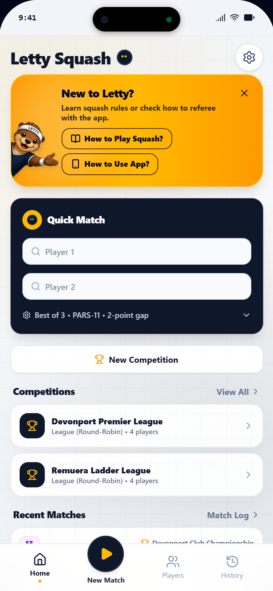
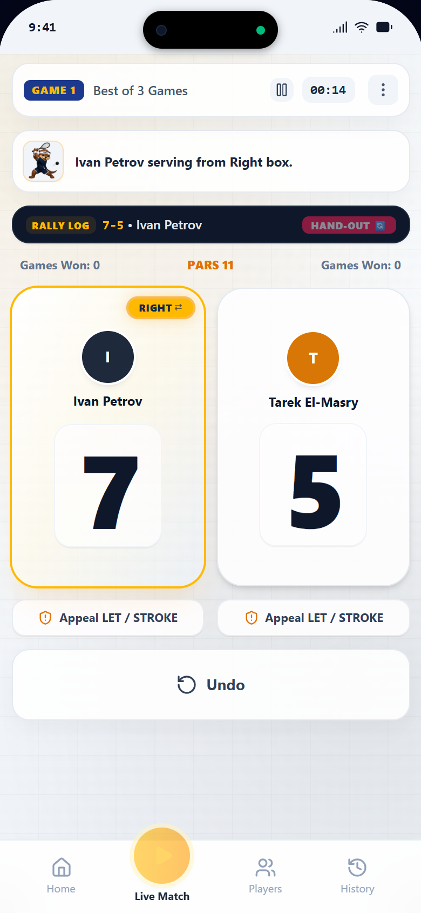
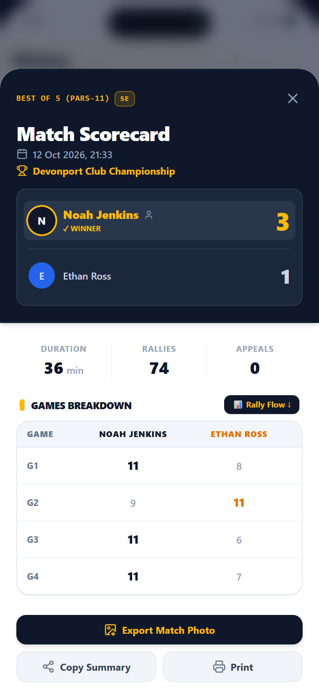
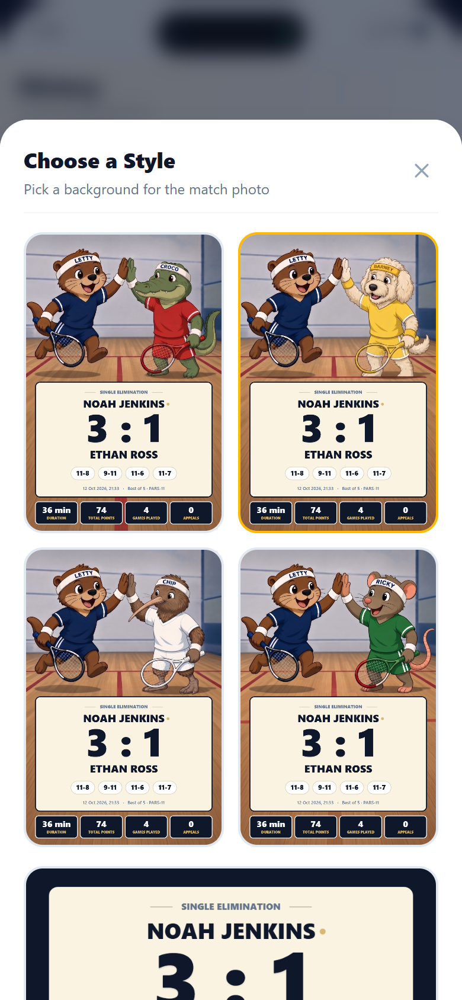
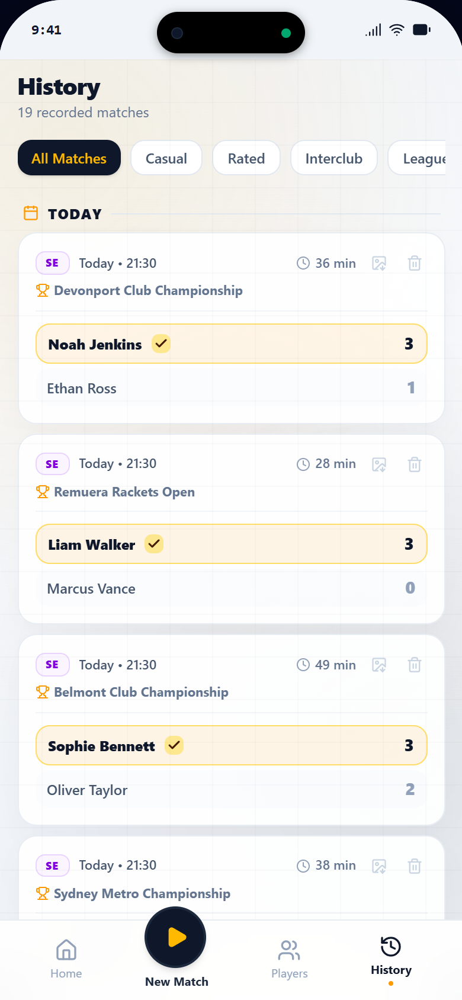
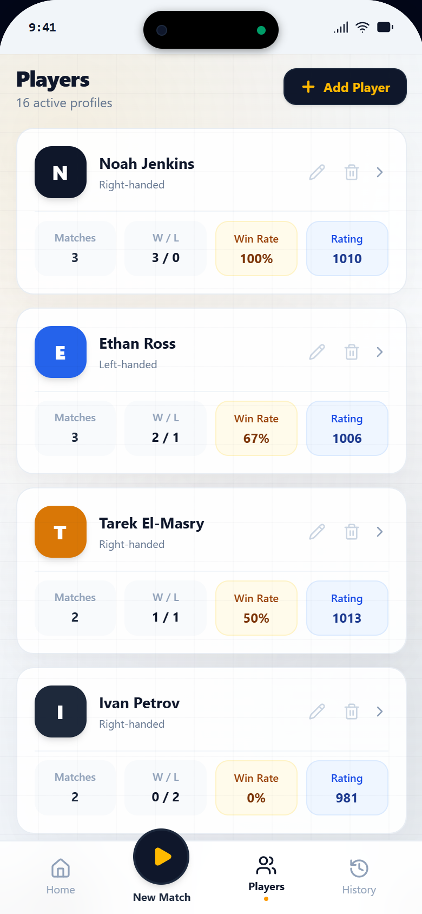

# Letty Squash

A squash scoring app for players who referee their own matches. Score a match
point by point on your phone, let the app keep track of the serve and the score,
and share a result card when it's over. Letty the otter keeps you company.

**Live demo:** https://letty-squash.vercel.app

| Home | Live scoreboard | Match scorecard |
| --- | --- | --- |
|  |  |  |

## Features

- **Live scoreboard** — tap a player to give them the point. The app tracks the
  server, the service box and hand-outs, keeps a rally log and a match timer, and
  lets you undo a mistake.
- **Referee decisions** — handle an appeal as a let, a stroke or no let.
- **Match formats** — best of 3, best of 5 or a single game; PARS to 11 or 15;
  optional two-point gap at deuce and handicap starts.
- **Quick Match** — pick two players on the home screen and start refereeing.
- **Competitions** — leagues (round-robin), interclub 4v4, groups with knockout,
  single and double elimination.
- **Match history** — every match with its duration, rally count, appeals and a
  game-by-game breakdown, plus a rally-flow view of how the points went.
- **Match photo** — export a result card to share: four mascot backgrounds, a plain
  navy one, or your own photo behind the score.
- **Players** — profiles with handedness, matches played, win/loss record, win rate
  and rating. Group players into folders.
- **Built-in guides** — how to play squash and how to use the app.
- **Works offline** — everything is stored in the browser, with no account and no
  server.

| Match photo styles | History | Players |
| --- | --- | --- |
|  |  |  |

The screenshots show the demo data the app starts with.

## Tech

- React 19 and TypeScript, built with Vite
- Tailwind CSS
- `lucide-react` for icons, `canvas-confetti` for the winner's moment
- `localStorage` for persistence
- Oxlint for linting

On a desktop the app is shown inside an iPhone frame; a switch at the top changes
it to fullscreen.

The `ios/` folder holds a SwiftUI version of the app.

## Run it locally

```bash
npm install
npm run dev
```

Then open the address Vite prints (http://localhost:5173 by default).

| Command | What it does |
| --- | --- |
| `npm run dev` | Development server |
| `npm run build` | Type-check and build to `dist/` |
| `npm run preview` | Serve the production build locally |
| `npm run lint` | Run Oxlint |

## Project notes

Working notes — the audit, the backend plan and the to-do lists — are in
[docs/notes/](docs/notes/). Most of them are in Russian.
